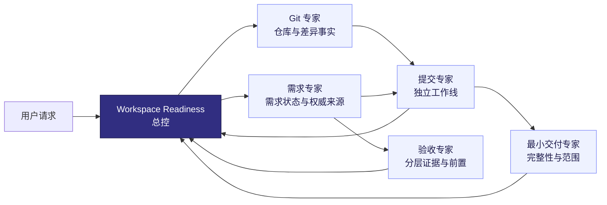

<div align="center">

# Workspace Readiness Skills

### 让 Git、需求、提交、验收与最小交付各归其位

一个默认只读、证据优先的 AI Skill 专家团，用于回答软件交付前最容易混在一起的五个问题。

[](#专家团)
[](#安全边界)
[](#核心原则)
[](LICENSE)

</div>

---

## 它解决什么问题

一个工作区“看起来干净”，并不代表需求已经完成；代码可以提交，也不代表已经具备验收条件；测试通过，更不等于已经发布或完成业务验收。

Workspace Readiness 把这些判断交给相互独立的专家，再由总控统一汇总：

- 工作区是否干净，改动属于哪条工作线？
- 当前会话、Codex 任务、sessions 和规格制品中还有什么没完成？
- 混合工作区应该拆成哪些独立提交？
- 哪些工作已经具备验收前置，哪些只完成了本地验证？
- 当前方案是否是最小完整交付，还是缺闭环或过度设计？

## 专家团



| Skill | 只负责 | 明确不负责 |
|---|---|---|
| [`workspace-readiness`](skills/workspace-readiness/) | 调度、关联证据包、冲突裁决、最终报告 | 替代专家做领域判断 |
| [`workspace-readiness-git`](skills/workspace-readiness-git/) | Git 根、状态、diff、分支、stash、冲突 | 需求完成、提交质量、验收 |
| [`workspace-readiness-requirements`](skills/workspace-readiness-requirements/) | 会话、任务、sessions、规格制品与需求状态 | Git 清洁度、提交边界、验收 |
| [`workspace-readiness-commit`](skills/workspace-readiness-commit/) | 拆分独立工作线、判断本地提交就绪度 | 需求完成、部署、业务验收 |
| [`workspace-readiness-acceptance`](skills/workspace-readiness-acceptance/) | 验收契约、环境前置、分层证据、新鲜度 | Git 状态、提交组合 |
| [`workspace-readiness-minimum`](skills/workspace-readiness-minimum/) | 最小完整行为、缺失闭环、过度设计 | 提交或验收结论 |

## 核心原则

1. **Git 不是需求系统**：工作区干净不能证明会话需求已经完成。
2. **证据分层**：源码、测试、构建、数据库、运行时、浏览器、发布制品、环境配置、部署和业务验收分别报告。
3. **缺证据就写 UNKNOWN**：不通过文件名、分支名或任务状态猜测完成情况。
4. **专家不可越权**：每个专家只能使用自己的状态词；可以指出矛盾，但不能覆盖其他专家的结论。
5. **默认只读**：扫描不会暂存、提交、切分支、应用 stash、推送、部署或启动真实业务验收。

## 快速开始

### 1. 克隆

```bash
git clone https://github.com/itsonglei/workspace-readiness-skills.git
cd workspace-readiness-skills
```

### 2. 安装全部 Skills

把 `skills/` 下的六个目录复制或链接到宿主的 Skill 目录。以 Codex 为例：

```bash
mkdir -p "${CODEX_HOME:-$HOME/.codex}/skills"
for skill_dir in "$PWD"/skills/*; do
  ln -s "$skill_dir" "${CODEX_HOME:-$HOME/.codex}/skills/$(basename "$skill_dir")"
done
```

如果目标名称已经存在，请先人工确认来源；安装命令不会覆盖现有目录或链接。

### 3. 调用

```text
$workspace-readiness
$workspace-readiness git
$workspace-readiness requirements <主题>
$workspace-readiness commit <工作线>
$workspace-readiness accept <工作线>
$workspace-readiness verify <工作线>
```

默认 `scan` 会执行完整专家团；针对性命令只加载必要专家，减少上下文和 Token 消耗。

## 它会读取什么

完整扫描会按相关性读取，而不是无边界遍历：

- 当前对话中的目标、纠正、非目标和硬性停止条件；
- 当前工作区可读取的 Codex 任务；
- `sessions/` 中与主题、时间、路径或规格标识相关的记录；
- 工作区清单路由的 Roadmap、`spec.md`、`tasks.md`、`verification.md`、`handoff.md` 和 closeout；
- 实际 Git diff、提交、分支和 stash；
- 与改动相连的测试、契约、迁移和消费者。

## 输出模型

总控最终输出一张互不串线的决策表：

| Workline | Git | Requirement | Commit | Acceptance | Minimum delivery |
|---|---|---|---|---|---|
| 示例 | `DIRTY_SCOPED` | `OPEN` | `READY` | `NOT_READY` | `PASS` |

状态词定义集中在 [`readiness-model.md`](skills/workspace-readiness/references/readiness-model.md)。其中：

- `READY` 只代表可以形成一个本地提交；
- `READY_TO_ACCEPT` 只代表具备启动验收的条件；
- `ACCEPTED` 必须有目标环境中的当前证据；
- 任一列的成功状态都不会自动传播到其他列。

## 安全边界

默认扫描不会执行：

- `git add`、commit、push、merge、rebase、reset 或 clean；
- stash apply/drop 或强制切换分支；
- 发布制品、环境配置、部署和共享环境变更；
- 浏览器登录态操作、数据库写入或真实业务验收；
- 自动修改规格状态或运行具备写入能力的收敛流程。

`verify` 模式也只会运行用户明确授权的检查。外部系统、认证环境和状态变更需要单独授权。

## 仓库结构

```text
workspace-readiness-skills/
├── README.md
└── skills/
    ├── workspace-readiness/              # 总控、状态模型、专家交接协议
    ├── workspace-readiness-git/          # Git 事实采集
    ├── workspace-readiness-requirements/ # 需求证据账本
    ├── workspace-readiness-commit/       # 提交工作线拆分
    ├── workspace-readiness-acceptance/   # 验收分层判断
    └── workspace-readiness-minimum/      # 最小完整交付检查
```

## 验证

发布前应至少完成：

- 六个 Skill 的 frontmatter 与目录结构校验；
- Git 采集器对单仓、多仓、未跟踪文件、重命名和冲突的 smoke test；
- “Git CLEAN 但需求未完成”的冲突测试；
- 混合 diff 拆分与 `UNATTRIBUTED` 变更测试；
- 专家越权检查：提交专家不得宣布验收，Git 专家不得宣布需求完成。

## 许可证

本项目采用 [MIT License](LICENSE)。

---

<div align="center">

**Clean Git is a fact. Delivery readiness is a judgment. Keep them separate.**

</div>
